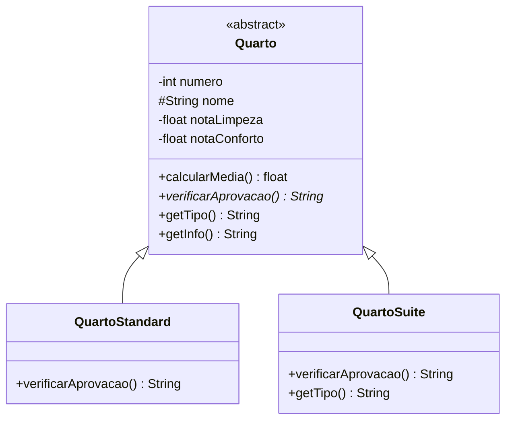

# padrao-template-method

Inspeção de quartos de um Hotel: o quarto recebe notas de limpeza e conforto, e cada categoria tem seu próprio critério de aprovação (Standard: média ≥ 6; Suíte: média ≥ 8).

`getInfo()` é o método-template: define o algoritmo fixo e chama o passo abstrato `verificarAprovacao()` e o gancho `getTipo()`.

Diagrama de classes:

O arquivo `diagrama_classe_template_method.mdj` contém o mesmo diagrama para abrir no StarUML.
# padrao-templatemethod
